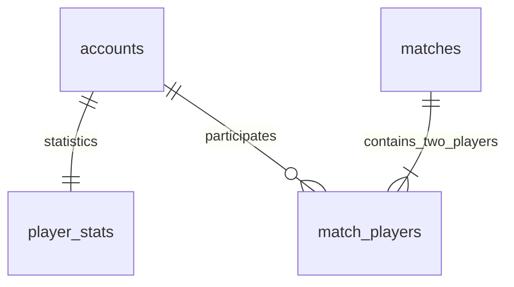

# Database – Fruit Battle Online

Database chính có **đúng 4 bảng nghiệp vụ**: `accounts`, `player_stats`, `matches`, `match_players`. Thiết kế phục vụ các luồng trong [NGHIEP_VU_GAME.md](NGHIEP_VU_GAME.md), không tạo bảng riêng cho xác thực, lịch sử, xếp hạng hay quản lý phiên bản schema.

Dùng MySQL 8.0.16+, InnoDB, `utf8mb4`. DDL ở [database/fruit_battle_schema.sql](database/fruit_battle_schema.sql), bản đóng gói cho server ở [src/main/resources/fruit/db/schema.sql](src/main/resources/fruit/db/schema.sql). Hai bản phải có cùng nội dung. Ngày cập nhật: 31/10/2026.

## 1. Các bảng và nghiệp vụ

| Bảng | Nghiệp vụ | Quan hệ |
|---|---|---|
| `accounts` | Đăng ký, đăng nhập, hồ sơ, quyền PLAYER/ADMIN, khóa/mở khóa | Một tài khoản có một dòng thống kê và tham gia nhiều trận |
| `player_stats` | Hồ sơ thống kê và bảng xếp hạng | `account_id` vừa là PK vừa là FK đến tài khoản |
| `matches` | Thông tin chung của trận đã hoàn thành | Một trận có đúng hai người tham gia do server kiểm tra |
| `match_players` | Kết quả cá nhân và lịch sử | Liên kết tài khoản với trận; giữ tên hiển thị lúc kết thúc |



Không có bảng `rooms`, `match_history`, `leaderboards`, `fruits`, `skills`, `matchmaking_queue` hay `schema_history`. Hàng đợi và trạng thái thi đấu nằm trong RAM. Lịch sử và bảng xếp hạng lấy từ bốn bảng trên.

## 2. Thuộc tính

### accounts

| Cột | Kiểu | Ý nghĩa |
|---|---|---|
| `id` | INT, PK | ID dương do server cấp |
| `username` | VARCHAR(24), UNIQUE | Tên đăng nhập ASCII, duy nhất không phân biệt hoa/thường |
| `display_name` | VARCHAR(96) | Tên hiển thị hiện tại; ứng dụng giới hạn 2–24 ký tự theo kiểm tra hiện hành |
| `password_hash` | VARCHAR(128) | Hash mật khẩu |
| `password_salt` | VARCHAR(64) | Salt riêng của tài khoản |
| `role` | ENUM | PLAYER hoặc ADMIN |
| `locked` | BOOLEAN | Trạng thái khóa |
| `avatar_id` | TINYINT UNSIGNED, DEFAULT 0 | Chân dung 0 (nhà vườn) hoặc 1 (cô làm vườn); CHECK giới hạn hai lựa chọn |
| `created_at` | DATETIME(6), nullable | Thời điểm tạo; NULL nếu nguồn cũ không ghi nhận |
| `updated_at` | DATETIME(6) | Thời điểm cập nhật dòng tài khoản |

Mật khẩu sử dụng PBKDF2WithHmacSHA256, 120.000 vòng, khóa 256 bit. Thuật toán và số vòng là quy ước trong `features/accounts/User.java`, không cần một bảng xác thực riêng. Không gửi hash/salt trong hồ sơ công khai hay dữ liệu quản trị.

Khi server mở schema bốn bảng hiện có, `DatabaseSchema` tự thêm `avatar_id` nếu thiếu, mặc định 0; giữ nguyên tài khoản, thống kê và lịch sử. Avatar được cập nhật cùng hồ sơ, trả về sau đăng nhập và trong trạng thái trận. Không cần thêm bảng avatar. Thời gian trong DB/giao thức vẫn là UTC; giao diện đổi sang giờ địa phương với định dạng `dd/MM/yyyy HH:mm`.

### player_stats

| Cột | Kiểu | Ý nghĩa |
|---|---|---|
| `account_id` | INT, PK/FK | Tham chiếu accounts.id |
| `wins` | INT UNSIGNED | Số trận thắng |
| `losses` | INT UNSIGNED | Số trận thua |
| `draws` | INT UNSIGNED | Số trận hòa |
| `total_score` | INT có dấu | Tổng điểm tích lũy, có thể âm |

Đây là bảng tổng hợp để đọc nhanh. Server cập nhật cùng transaction với kết quả trận và ghi tổng tuyệt đối khi thử lưu lại, không cộng lại một trận nhiều lần. Migration giữ nguyên tổng cũ vì lịch sử cũ có thể không đầy đủ.

### matches

| Cột | Kiểu | Ý nghĩa |
|---|---|---|
| `id` | CHAR(36), PK | UUID trận |
| `created_at` | DATETIME(6) | Lúc ghép trận |
| `finished_at` | DATETIME(6), nullable | Lúc kết thúc; NULL nếu dữ liệu cũ không có |
| `duration_ms` | INT UNSIGNED, nullable | Thời gian thi đấu 0–60.000 ms, không gồm đếm ngược |
| `finish_reason` | ENUM | TIME_UP hoặc ACCOUNT_LOCKED |

Không lưu thêm người thắng ở bảng này. Kết quả cá nhân tại `match_players.outcome` đã xác định người thắng hoặc trận hòa. Trường `winnerId` trong giao thức client vẫn được dựng lại từ kết quả cá nhân, nên giao diện không phải thay giao thức.

### match_players

| Cột | Kiểu | Ý nghĩa |
|---|---|---|
| `match_id` | CHAR(36), PK/FK | Tham chiếu matches.id |
| `account_id` | INT, PK/FK | Tham chiếu accounts.id |
| `slot` | TINYINT UNSIGNED | Vị trí 1 hoặc 2 |
| `display_name_snapshot` | VARCHAR(96) | Tên tại lúc ghi kết quả, không đổi theo hồ sơ sau này |
| `outcome` | ENUM | WIN, LOSS hoặc DRAW |
| `score` | INT có dấu | Điểm trong trận, có thể âm |
| `correct`, `wrong`, `bombs` | INT UNSIGNED | Số lần hứng đúng, sai, bom |
| `max_combo` | INT UNSIGNED | Combo cao nhất |
| `skills_used` | INT UNSIGNED | Số lần sử dụng kỹ năng |

PK `(match_id, account_id)` chống trùng người trong trận. UNIQUE `(match_id, slot)` chống trùng vị trí. Tên đăng nhập lấy qua `accounts` vì nghiệp vụ không cho đổi username; chỉ tên hiển thị cần snapshot.

## 3. Ràng buộc và chỉ mục

Database kiểm tra khóa chính, username duy nhất, các khóa ngoại, slot 1/2, thời lượng không quá 60.000 ms và bộ đếm không âm. Điểm không đặt UNSIGNED.

Server kiểm tra toàn bộ kết quả có đúng hai tài khoản khác nhau, người thắng thuộc trận, các chỉ số hợp lệ và kết quả hai dòng nhất quán: WIN–LOSS hoặc DRAW–DRAW. Khi đọc SQL, server cũng kiểm tra cặp outcome, không chấp nhận hai WIN hay hai LOSS.

Các chỉ mục chính phục vụ username, lọc quyền/trạng thái khóa, thứ tự xếp hạng `(wins DESC, total_score DESC, account_id)`, thời gian trận và tìm các trận theo tài khoản. Không tự xóa dây chuyền lịch sử; nghiệp vụ hiện chỉ khóa tài khoản, không xóa tài khoản.

Thời gian lưu UTC. Kết nối đặt `time_zone='+00:00'`; repository dùng LocalDateTime UTC và chuẩn hóa xuống microsecond khi ghi DATETIME(6).

## 4. Transaction và chống lưu trùng

Lưu tài khoản gồm accounts và player_stats trong cùng transaction. Lưu trận gồm hai tài khoản/thống kê, matches và đúng hai dòng match_players trong cùng transaction. Một bước lỗi sẽ rollback toàn bộ lần ghi.

Mã trận và PK người tham gia không thay đổi khi thử lưu lại. Hai dòng kết quả được thay thế trong transaction và thống kê ghi bằng tổng tuyệt đối do engine quản lý, nên retry không cộng thêm lần nữa. Server vẫn là nguồn quyết định kết quả; client không tự gửi điểm để ghi SQL.

## 5. Tạo mới và kiểm tra database

```powershell
powershell -ExecutionPolicy Bypass -File .\run.ps1 -Mode database
```

Lệnh tạo/kiểm tra schema 4 bảng, không mở server game. Khởi động server bằng `-Mode server` cũng kiểm tra schema trước khi nhận kết nối. Cấu hình mặc định: database fruit_battle, user root, password 123456; có thể ghi đè bằng FRUIT_DB_URL, FRUIT_DB_USER và FRUIT_DB_PASSWORD.

Để tạo thủ công trong MySQL client:

```sql
CREATE DATABASE IF NOT EXISTS fruit_battle CHARACTER SET utf8mb4;
USE fruit_battle;
SET time_zone='+00:00';
SOURCE database/fruit_battle_schema.sql;
```

Mã chuyển đổi từ bản 2/6 bảng đã được xóa sau khi chuyển dữ liệu thật hoàn tất. Chương trình chỉ hỗ trợ database 4 bảng hiện tại hoặc database trống; nếu phát hiện bảng khác, chương trình báo lỗi và giữ nguyên dữ liệu đó.

SQL backup trước lần chuyển vẫn được giữ ở `data/backups/fruit_before_v3_2a78055fabdf4b85bfb144817a837580.sql`. Nếu cần kiểm tra backup cũ, phục hồi vào một database trống riêng; bản chương trình hiện tại không tự chuyển cấu trúc của bản backup cũ. Không import đè lên database đang chạy.

## 6. Truy vấn nghiệp vụ

### Bảng xếp hạng

```sql
SELECT a.id,a.username,a.display_name,s.wins,s.losses,s.draws,s.total_score
FROM accounts a JOIN player_stats s ON s.account_id=a.id
WHERE a.role='PLAYER' AND a.locked=FALSE
ORDER BY s.wins DESC,s.total_score DESC,s.account_id ASC
LIMIT 100;
```

### Lịch sử một người chơi

```sql
SELECT m.id,m.created_at,m.finished_at,m.duration_ms,m.finish_reason,
       other.display_name_snapshot AS opponent,
       own.score AS own_score,other.score AS opponent_score,own.outcome,
       own.correct,own.wrong,own.bombs,own.max_combo,own.skills_used
FROM match_players own
JOIN matches m ON m.id=own.match_id
JOIN match_players other ON other.match_id=own.match_id AND other.account_id<>own.account_id
WHERE own.account_id=123
ORDER BY m.created_at DESC,m.id DESC
LIMIT 100;
```

### Kiểm tra các trận không có đủ hai người

```sql
SELECT m.id,COUNT(p.account_id) AS participants
FROM matches m LEFT JOIN match_players p ON p.match_id=m.id
GROUP BY m.id HAVING COUNT(p.account_id)<>2;
```

Kết quả truy vấn cuối phải rỗng với dữ liệu hợp lệ. Tránh chỉnh thống kê trực tiếp trong SQL khi server đang chạy vì engine giữ trạng thái tài khoản trong bộ nhớ.

## 7. Kiểm chứng

Sau khi dọn mã chuyển đổi cũ ngày 01/11/2026, bộ kiểm thử hiện tại PASS 365 kiểm tra trong 68,5 giây. Các kiểm thử chuyển đổi/fixture cũ đã được loại bỏ cùng phần code tương ứng; kiểm thử schema hiện tại, transaction, lưu/đọc và khởi động lại được giữ.

`src/test/java/fruit/server/infrastructure/persistence/DatabaseTest.java` kiểm tra schema đúng bốn bảng, FK/UNIQUE/CHECK, điểm âm, cặp outcome, snapshot tên, UTC, transaction rollback, retry không cộng trùng, tài khoản/kết quả sau khởi động lại, cổng bận và từ chối schema không được hỗ trợ.

```powershell
powershell -ExecutionPolicy Bypass -File .\run.ps1 -Mode test -MySqlTest
```

Kiểm thử tạo database riêng có tiền tố fruit_battle_test_, không dùng dữ liệu thật để sửa hoặc xóa.

Kết quả đợt chuyển dữ liệu trước khi dọn code: bộ kiểm thử đầy đủ PASS 397 kiểm tra, trong đó có 64 kiểm tra SQL/migration. Database `fruit_battle` thực tế đã chuyển về đúng 4 bảng, giữ 3 tài khoản, 7 trận, 14 dòng match_players và 3 dòng player_stats. Hai truy vấn kiểm tra thiếu người/kết quả không hợp lệ đều trả về 0 lỗi. Chạy lại `-Mode database` không thay đổi số liệu.

Sao lưu trước chuyển: `data/backups/fruit_before_v3_2a78055fabdf4b85bfb144817a837580.sql`. Chi tiết kiểm chứng code/giao diện ở [FEATURE_REFACTOR.md](FEATURE_REFACTOR.md).
